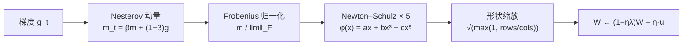

# Muon 优化器

> Muon（**M**oment**u**m **O**rthogonalized by **N**ewton–Schulz）是 Keller Jordan 等人在 2024 年 12 月提出的优化器：每一步先做 SGD-Nesterov 动量，再把动量矩阵**正交化**（取近似极分解 $UV^\top$）当作更新方向。它只用于隐藏层的 2D 权重，embedding、输出头、Norm 和 bias 仍交给 AdamW。

| 项目 | 内容 |
|------|------|
| 提出 | Keller Jordan 等，2024-12-08 |
| 核心操作 | Newton–Schulz 迭代 5 步，bf16 下稳定 |
| 适用参数 | 隐藏层 2D 权重；4D 卷积可 flatten 成 2D |
| 实测收益 | nanoGPT speedrun 提速 1.35×；CIFAR-10 94% 从 3.3 → 2.6 A100-秒 |
| FLOP 开销 | 至多 $Tm/B$，典型训练下 < 1% |
| 大规模落地 | Moonlight（3B/16B MoE）、Kimi K2（1T）、GLM-4.5（355B）、DeepSeek-V4 |

资料：[Muon 博客](https://kellerjordan.github.io/posts/muon/) · [参考实现](https://github.com/KellerJordan/Muon) · [Moonlight 论文](https://arxiv.org/abs/2502.16982) · [Kimi K2 技术报告](https://arxiv.org/abs/2507.20534)

## 1. 动机：AdamW 缺了矩阵结构

AdamW 把每个参数当独立标量，用一阶、二阶矩逐元素缩放：

$$
\Delta W = -\eta \frac{\hat m}{\sqrt{\hat v} + \epsilon}
$$

这在元素层面是合理的，但它对"一层权重是一个矩阵"这件事完全无感。实测 transformer 隐藏层里，SGD 动量或 Adam 产生的更新矩阵**条件数很高、几乎低秩**：少数几个方向独占绝大多数能量，其余方向被压得很小。

如果这些"罕见方向"其实对学习有用，那 AdamW 的做法就是在浪费它们。Muon 的出发点很直接：别逐元素缩放，改成**整个矩阵一起缩放**，把更新矩阵的谱（奇异值）压平。

## 2. 从谱范数最速下降到 Muon

### 2.1 更新方向就是极分解

把损失在当前点线性化，并约束更新矩阵的**谱范数**（最大奇异值）不超过 $\eta$：

$$
\min_{\|\Delta W\|_2 \le \eta} \langle G, \Delta W \rangle
\quad\Longrightarrow\quad
\Delta W^\star = -\eta\, UV^\top,
\qquad G = U\Sigma V^\top
$$

对 $G$ 做 SVD，最优更新方向是 $UV^\top$——也就是 $G$ 的**极分解**（polar factor）：所有奇异值都被拉平成 1，只保留方向信息。

$$
\mathrm{Ortho}(G) = \arg\min_{O^\top O = I \,\text{或}\, OO^\top = I} \|O - G\|_F = UV^\top
$$

对应的就是"正交化"这个操作：找到离 $G$ 最近的（半）正交矩阵。对非方阵，$UV^\top$ 满足 $O^\top O = I$ 或 $OO^\top = I$ 中维度较小的那个。

!!! note "为什么叫谱范数最速下降"
    AdamW 可以看成在**逐元素（max 范数）**意义下做最速下降——每个坐标有自己的步长；Muon 则是在**谱范数**意义下做最速下降——整个矩阵共享一个尺度。Bernstein 与 Newhouse 的 [modular duality](https://arxiv.org/abs/2410.21265) 把这套"换一个范数就换一个优化器"的说法系统化了：梯度是某个对偶空间里的向量，必须先经 duality map 回到权重空间；对线性层、在算子范数下这个映射恰好是 $UV^\top$。

### 2.2 和 AdamW、Shampoo 的关系

- **AdamW**：逐元素除以 $\sqrt{\hat v}$，等价于每个坐标独立调步长。
- **Shampoo**：维护梯度协方差并做逆四次根预条件。把累积去掉后，一步更新正好是 $(GG^\top)^{-1/4}G(G^\top G)^{-1/4} = UV^\top$。所以 **Muon ≈ "无累积的瞬时 Shampoo"**，只是用 NS 迭代代替了逆四次根，代价低得多。
- **Orthogonal-SGDM（2022）**：先对梯度做 SVD 正交化、再加动量。Muon 把动量挪到正交化**之前**（效果更好），并用 NS 迭代代替 SVD。
- **更早的 stochastic spectral descent（2015）**：同样是正交化的思路，但用 SVD、没有动量。

## 3. Newton–Schulz 迭代

### 3.1 一步迭代 = 对奇异值作用一个五次多项式

直接算 SVD 太慢。NS 迭代只做矩阵乘法，输入 $G = USV^\top$ 时，一步迭代为：

$$
\begin{aligned}
G' &= aG + b(GG^\top)G + c(GG^\top)^2 G \\
&= \big(aI + b\,US^2U^\top + c\,US^4U^\top\big)USV^\top \\
&= U\,\varphi(S)\,V^\top,
\qquad \varphi(x) = ax + bx^3 + cx^5
\end{aligned}
$$

也就是说，$N$ 步迭代等价于对每个奇异值独立地作用 $N$ 次 $\varphi$。想让结果收敛到 $UV^\top$，只需要：

1. 初值所有奇异值落在 $[0, 1]$ 内；
2. 系数 $(a, b, c)$ 使得 $\varphi^N(x) \to 1$。

第 1 条用 Frobenius 归一化就能满足：$X \leftarrow G / \|G\|_F$，此时 $\sigma_{\max} \le 1$。而且 $\mathrm{Ortho}(cG) = \mathrm{Ortho}(G)$，缩放本身不改变结果。

### 3.2 系数为什么长这样

朴素的选择是 $(a, b, c) = (2, -1.5, 0.5)$，已经能收敛。Keller 进一步调优，思路是：

- $a = \varphi'(0)$ 决定**小奇异值**的收敛速度，所以 $a$ 越大越好；
- 但约束是 $\varphi^N(x)$ 最终落在 $[1-\varepsilon, 1+\varepsilon]$ 内。

关键经验是：$\varepsilon$ 大到 **0.3** 也不损伤训练效果。于是问题变成"在 $\varphi^N(x) \in [0.7, 1.3]$ 的约束下把 $a$ 推到最大"，最后得到：

$$
(a, b, c) = (3.4445,\ -4.7750,\ 2.0315)
$$

| 输入 $\sigma$ | $\varphi(\sigma)$ | $\varphi^2(\sigma)$ | $\varphi^5(\sigma)$ |
|---|---|---|---|
| 0.05 | 0.172 | 0.567 | 0.758 |
| 0.20 | 0.651 | 1.162 | 0.747 |
| 0.50 | 1.189 | 0.896 | 0.765 |
| 0.70 | 1.115 | 0.722 | 1.120 |
| 1.00 | 0.701 | 1.114 | 0.696 |

注意它**不收敛到 1，而是在 [0.7, 1.2] 附近振荡**（官方 README 记录的实际区间是 [0.68, 1.13]）。这正是设计意图：牺牲"精确正交"，换"5 步就进带内"。所以 Muon 实际拿到的是 $US'V^\top$，$S'_{ii}$ 大致在 $[0.5, 1.5]$ 内分布，而不是严格的 $UV^\top$——实验上完全不影响效果。

### 3.3 为什么 5 步够、为什么 bf16 能跑

- 5 步是 wallclock 与精度的折中；试过三阶、七阶多项式，墙钟开销都没再降低。
- NS 迭代在 bf16 下数值稳定，这是选它而不选"耦合牛顿迭代"的根本原因——后者至少要 fp32，在 GPU 上慢得多。
- 每步 3 次矩阵乘法（$XX^\top$、$A^2$、$BX$），5 步共 15 次，在 bf16 tensor core 上很快，且可以 batched。
- 顺带一提：Frobenius 归一化其实是"比需要的更强"的条件。Bernstein 的 cubic 迭代只要求初始奇异值 $\le \sqrt{3}$ 就收敛，这里用 $\|G\|_F$ 归一化纯粹是为了简单。

## 4. 完整算法

### 4.1 公式

设第 $t$ 步梯度 $g_t$、动量缓冲 $m_t$、衰减 $\beta$：

$$
m_t = \beta m_{t-1} + (1-\beta) g_t
$$

Nesterov 版本用 $\tilde g_t = \beta m_t + (1-\beta) g_t$ 代替 $m_t$。然后：

$$
u_t = \varphi^{5}\!\left(\frac{\tilde g_t}{\|\tilde g_t\|_F}\right)
\cdot \max\!\left(1, \frac{\text{rows}}{\text{cols}}\right)^{1/2}
$$

$$
W_{t+1} = (1 - \eta_t \lambda)\, W_t - \eta_t\, u_t
$$

缩放项 $\sqrt{\max(1, \text{rows}/\text{cols})}$ 用来补偿矩阵形状：$n \times m$ 的半正交矩阵元素 RMS 约 $1/\sqrt{\max(n,m)}$，不缩放的话宽层和窄层的更新幅度差别很大。这个形状项也有理论出处：在 RMS→RMS 诱导范数下，线性层的对偶映射正是 $\sqrt{d_{\text{out}}/d_{\text{in}}}\cdot UV^\top$（Bernstein & Newhouse, Example 3）。



### 4.2 超参

| 超参 | 典型值 | 说明 |
|------|--------|------|
| `lr` | 0.02（Keller 原版） | 语义是"每步谱范数"，不是 AdamW 的 lr |
| `momentum` | 0.95 | Nesterov 写法，实测略优于普通动量 |
| `ns_steps` | 5 | 3~5 均可，5 是默认 |
| `weight_decay` | 0.1 量级 | 大模型上**必须**加，Moonlight 的关键结论之一 |
| 更新 RMS | 0.2 | Moonlight / GLM-4.5 用它把 Muon 的 lr 对齐到 AdamW 尺度 |

对齐 AdamW 的常用写法是乘 $0.2\sqrt{\max(A, B)}$，让 Muon 更新的元素 RMS ≈ 0.2。这样 lr 可以沿用 AdamW 的量级，不用重新扫。

### 4.3 参考实现

```python
import torch

def zeropower_via_newtonschulz5(G, steps=5, eps=1e-7):
    """Newton–Schulz 迭代，近似正交化：返回 G 的极分解因子 UV^T"""
    a, b, c = (3.4445, -4.7750, 2.0315)
    X = G.bfloat16()
    if G.size(-2) > G.size(-1):
        X = X.mT
    X = X / (X.norm(dim=(-2, -1), keepdim=True) + eps)  # 保证谱范数 ≤ 1
    for _ in range(steps):
        A = X @ X.mT
        B = b * A + c * A @ A
        X = a * X + B @ X
    if G.size(-2) > G.size(-1):
        X = X.mT
    return X


def muon_update(grad, momentum, beta=0.95, ns_steps=5, nesterov=True):
    momentum.lerp_(grad, 1 - beta)                 # m ← βm + (1-β)g
    update = grad.lerp_(momentum, beta) if nesterov else momentum
    if update.ndim == 4:                           # 卷积核 flatten 成 2D
        update = update.view(len(update), -1)
    update = zeropower_via_newtonschulz5(update, steps=ns_steps)
    update *= max(1, update.size(-2) / update.size(-1)) ** 0.5
    return update
```

完整版（`MuonWithAuxAdam`）在同一个 optimizer 里维护 Muon 与 AdamW 两组参数，见 [KellerJordan/Muon](https://github.com/KellerJordan/Muon)。

## 5. 哪些参数交给 Muon

| 参数 | 优化器 | 原因 |
|------|--------|------|
| Attention / FFN / MoE 专家的 2D 权重 | **Muon** | 梯度矩阵接近满秩，正交化有意义 |
| Embedding | AdamW | modular norm 理论：embedding 每个 token 只被激活一次，更新噪声极大，需要逐元素缩放 |
| 输出头（lm_head） | AdamW | 经验结论，理论解释还不完整 |
| bias / LayerNorm、RMSNorm 的 gain / 标量 | AdamW | 不是矩阵，无从正交化 |

两个容易漏的实践细节：

- **Q、K、V 分开做 Muon**，不要把 fused QKV 当一个矩阵。Keller 博客与社区实验都验证了分开更好。
- 4D 卷积核把后三维 flatten 成 2D 再用。CIFAR-10 speedrun 本身就是卷积网络，说明 ConvNet 也适用。

## 6. 工程实现

### 6.1 FLOP 开销

对 $n \times m$ 的矩阵（设 $m \le n$），每步 NS 迭代约 $2(2nm^2 + m^3) \le 6nm^2$ FLOPs，$T$ 步额外开销至多 $6Tnm^2$。而这一层一步训练（前向 + 反向）约 $6nmB$ FLOPs，$B$ 是 batch token 数。所以：

$$
\text{额外 FLOPs 占比} \le \frac{Tm}{B}
$$

- nanoGPT：$m = 768$、$B = 524288$，开销 $5 \times 768 / 524288 \approx 0.7\%$；
- Llama 405B 量级：$m = 16384$、$B \approx 1.6\times10^7$，开销 $\approx 0.5\%$。

**开销与模型宽度成正比、与 batch 成反比**，典型 LLM 训练下不到 1%，这是它比 Shampoo 实用的根本原因。

### 6.2 显存

Muon 只需一份动量缓冲（约等于 SGD），不需要 AdamW 的二阶矩。省下的显存可以换更大 batch 或更长序列。

### 6.3 分布式

NS 要求**拿到完整矩阵**，这是分布式下唯一的麻烦：

- 纯 DDP：梯度已经 all-reduce 过，每张卡都有完整梯度，NS 可以本地冗余算。Keller 的实现把参数按大小排序，每个 rank 只负责一部分参数的更新，最后 all-gather 参数。
- ZeRO-1 / FSDP：参数被切分，需先 `reduce_scatter` 梯度，再在 DP 组内 `gather` 拼回完整梯度矩阵、做 NS，之后只保留本地分片做更新，最后 all-gather 参数。Moonlight 把这套流程叫 "DP Gather + Calculate Full Update"，多出来的通信只是 DP 组内一次 gather，量级与 Adam 相当。
- 更省的做法见 [Dion](https://arxiv.org/abs/2504.05295)：在动量缓冲上做 amortized power iteration，不重建完整矩阵，天然适配 weight sharding。

## 7. 大规模落地

### 7.1 Moonlight：第一个证明"能规模化"的工作

[《Muon is Scalable for LLM Training》](https://arxiv.org/abs/2502.16982)（Moonshot，Jianlin Su 等在作者列表里）解决了两个工程问题：

1. **加 weight decay**：Muon 的更新谱范数恒定，不加 decay 权重范数会一直涨，最后涨出 bf16 的高精度范围；
2. **调每参数更新尺度**：满秩矩阵上 Muon 更新的元素 RMS 理论值是 $\sqrt{1/\max(A,B)}$（Lemma 1），乘上 $0.2\sqrt{\max(A,B)}$ 正好匹配 AdamW 的 update RMS，于是 lr / wd 可以直接复用 AdamW 的量级，不必重扫。

结论：scaling law 实验里 Muon 相对 AdamW 有约 **2× 计算效率**——精确说法是**达到同等 loss 只需约 52% 的训练 FLOPs**（不是 52% 的 token，常被误传）。据此训练的 Moonlight 是 3B 激活 / 16B 总参数的 MoE（正文口径 2.24B / 15.29B，不算 embedding），用 5.7T token，刷新了同算力下的 Pareto 前沿，并开源了分布式实现（[MoonshotAI/Moonlight](https://github.com/MoonshotAI/Moonlight)，Megatron-LM PR #1428）。其超参：NS 5 步、动量 0.95、峰值 lr $4.2\times10^{-4}$、wd 0.1。

### 7.2 Kimi K2 与 MuonClip

Kimi K2（1T 总参数 / 32B 激活）用 Muon 预训练 15.5T token。规模一大就出现了新问题：**attention 的 QK logits 爆炸**。MuonClip 在 Muon 之上加了一步 **QK-clip**：

$$
\gamma = \frac{\tau}{S_{\max}},
\qquad W_q \leftarrow \sqrt{\gamma}\, W_q,\quad W_k \leftarrow \sqrt{\gamma}\, W_k
$$

其中 $\ell$ 是某个 head 的 QK logits，$S_{\max} = \max_{i,j}|\ell_{ij}|$，$\gamma = \tau / S_{\max}$ 是缩放因子，$\tau$ 是阈值（K2 取 **100**）。只在该 head 的最大 logit 超过阈值时触发，因为 $(\sqrt{\gamma}Q)(\sqrt{\gamma}K)^\top = \gamma\, QK^\top$，刚好把最大 logit 压到 $\tau$。效果是**15.5T token 训练零 loss spike**，且几乎不增加开销：前 7 万步里约 12.7% 的 head 至少触发过一次，之后完全自动失效（self-deactivation）。

K2 的其它超参：base lr $2\times10^{-4}$、wd 0.1、global batch 67M token。报告还专门分析了**为什么 Muon 会把 logits 顶上去**（Appendix E）：msign 让更新的奇异值全部相等、有效秩满，而 Muon 训出的权重奇异值熵更高，于是更新的 $\bar u\bar v^\top$ 更容易和权重已有的 $u_iv_i^\top$ 对齐、把该奇异值加性抬高；再经过 attention 的 $W_qW_k^\top$（谱范数被平方）复合放大。vanilla Muon 训 9B/53B MoE 时，max logits 很快冲破 1000。

!!! tip "为什么不是 QK-Norm / soft-cap"
    logit soft-cap 会扭曲注意力分布；QK-Norm 归一化的是激活而不是权重，治标不治本。QK-clip 直接在权重上动手，保持注意力分布的相对形状。细节见 [Jianlin Su 的推导](https://kexue.fm/archives/11126) 与 [Fireworks 的可视化解释](https://fireworks.ai/research/muonclip-attention-score-explosions)。

### 7.3 GLM-4.5

[GLM-4.5 技术报告](https://arxiv.org/abs/2508.06471)（355B 总参数 / 32B 激活，23T token）明确写了：除 word embedding、bias 和 RMSNorm 权重外**全部用 Muon**，NS 步数 5、动量 0.95、更新 RMS 缩放到 0.2，weight decay 0.1，峰值 lr $2.5\times10^{-4}$。报告还提到 Muon "能加速收敛，并且容忍更大的 batch"。

### 7.4 其他

- **Essential AI**（[arXiv:2505.02222](https://arxiv.org/abs/2505.02222)）：把 Muon 放到 compute-time Pareto 前沿上显式优于 AdamW；关键结论是**大 batch（远超 critical batch size）下仍保持 data efficiency**，配合 muP 做超参迁移，实验到 4B 参数。
- **Polar Express**（[arXiv:2505.16932](https://arxiv.org/abs/2505.16932)）：用极小极大优化自适应地逐次选多项式，最坏情况误差最优，在 Muon 里稳定改善 val loss；nanoGPT 纪录 #38（2.476 min）。
- **NorMuon**（[arXiv:2510.05491](https://arxiv.org/abs/2510.05491)）：Muon 的变体，配合 cautious weight decay 把 nanoGPT 纪录刷到 #41（2.345 min）。
- **工程集成**：Muon 已进入 Megatron-LM 主线（PR #1428）。
- 本库 [DeepSeek-V4 笔记](../frontier/12-deepseek-v4.md)：大部分参数用 Muon，embedding、输出头、RMSNorm 仍用 AdamW。
- 更早的 Orthogonal-SGDM、stochastic spectral descent 是同一思路的前身，但都没在大规模上站住。

## 8. 为什么有效

几个互相补充的解释，目前没有定论：

1. **放大罕见方向**。实测更新矩阵近似低秩，正交化把被压住的奇异方向抬到同一量级，相当于给"少数派方向"更多步长。
2. **每层更新尺度恒定**。谱范数被钉在 1，深层网络不会出现某一层更新爆炸或消失，等效于给每层配了独立的学习率。
3. **条件数改善**。正交化后奇异值全为 1，梯度的病态程度不再传递到更新上。
4. **与 μP / modular norm 一致**。在谱范数下，超参可以跨宽度迁移——这解释了为什么 Moonlight 能"out-of-the-box"放大到 16B。
5. **理论进展**。[MVR 论文](https://arxiv.org/abs/2512.16598)（2025-12）在 Gluon 框架里把 vanilla 动量换成动量方差缩减，把 Muon 类方法的非凸收敛率从 $O(1/K^{1/4})$ 提到 $O(1/K^{1/3})$；[Polar Express](https://arxiv.org/abs/2505.16932) 则给出了多项式选择的极小极大最优性。但都还没有"全局最优"级别的保证。

## 9. 什么时候用、什么时候别用

| 场景 | 建议 |
|------|------|
| 从头预训练 Transformer | 首选，隐藏层 2D 权重换 Muon |
| 小模型 / speedrun | 收益明显，nanoGPT、CIFAR-10 都有记录 |
| MoE 预训练 | 已在 Moonlight、K2、GLM-4.5 验证 |
| 微调 / LoRA | 谨慎：低秩更新正交化意义不大，缺大规模对照 |
| RL 训练 | 证据在增加（K2 的后训练也用 Muon 系），但公开对照仍少，Keller 原博客把它列为开放问题 |
| 推荐 / embedding 重的模型 | 不适合，embedding 本来就该留在 AdamW |

!!! warning "换 Muon 必须重扫的超参"
    - **lr 语义变了**：0.02 是"每步谱范数"，与 AdamW 的 3e-4 不可直接换算；用 RMS 对齐（0.2 系数）过渡。
    - **weight decay 必须加**，否则权重范数随训练单调增长。
    - batch size 与 lr 的关系、warmup 比例都需要重新确认。

## 10. 常见问题

??? question "为什么不直接算 SVD？"
    SVD 精度最高但太慢，且难在 GPU 上高效批量做；耦合牛顿迭代能算极分解，但必须 fp32。NS 迭代是唯一"bf16 够用 + 纯 matmul + 5 步够"的方案。

??? question "为什么 5 步就够？"
    因为目标不是精确正交，而是进入 ±30% 的误差带。$\varphi^5$ 已经把 $[0,1]$ 映射到 $[0.7, 1.2]$ 附近（见 §3.2 的表），再迭代收益递减。

??? question "Muon 能替代 AdamW 吗？"
    不能。它是"隐藏层专用"的：embedding、输出头、Norm、bias 仍是 AdamW。实际训练里通常是 `MuonWithAuxAdam` 一个优化器管两组参数。

??? question "和 Shampoo 什么关系？"
    无累积的 Shampoo 更新就是 $UV^\top$。Muon 可以看作"用 NS 迭代近似实现的、带动量的瞬时 Shampoo"，FLOP 与通信都便宜得多。

??? question "小模型上值得吗？"
    值得先试。额外 FLOP 不到 1%，但收益依赖任务和基线调优程度——Keller 反复强调，比较 Muon 时必须先把 AdamW 基线调好，否则容易得出虚假结论。

??? question "训练崩了怎么办？"
    先看 attention logits。若出现尖峰，参考 MuonClip 的 QK-clip（$\tau = 100$）；同时检查 weight decay 是否生效、lr 是否过大。

## 11. 参考文献

1. Keller Jordan et al. *Muon: An optimizer for hidden layers in neural networks*. 2024. [博客](https://kellerjordan.github.io/posts/muon/) · [代码](https://github.com/KellerJordan/Muon)
2. Jeremy Bernstein, Laker Newhouse. *Modular Duality in Deep Learning*. [arXiv:2410.21265](https://arxiv.org/abs/2410.21265)
3. Jeremy Bernstein, Laker Newhouse. *Old Optimizer, New Norm: An Anthology*. [arXiv:2409.20325](https://arxiv.org/abs/2409.20325)
4. Tim Large et al. *Scalable Optimization in the Modular Norm*. [arXiv:2405.14813](https://arxiv.org/abs/2405.14813)
5. Jingyuan Liu, Jianlin Su et al. *Muon is Scalable for LLM Training*. [arXiv:2502.16982](https://arxiv.org/abs/2502.16982)（Moonlight）
6. Kimi Team. *Kimi K2: Open Agentic Intelligence*. [arXiv:2507.20534](https://arxiv.org/abs/2507.20534)（MuonClip）
7. GLM-4.5 Team. *GLM-4.5: Agentic, Reasoning, and Coding (ARC) Foundation Models*. [arXiv:2508.06471](https://arxiv.org/abs/2508.06471)
8. Essential AI. *Practical Efficiency of Muon for Pretraining*. [arXiv:2505.02222](https://arxiv.org/abs/2505.02222)
9. Jianlin Su. *Muon 优化器赏析：从向量到矩阵的本质跨越*. [kexue.fm/archives/10592](https://kexue.fm/archives/10592)
10. Jianlin Su. *MuonClip 与 QK-Clip 的推导*. [kexue.fm/archives/11126](https://kexue.fm/archives/11126)
11. Fireworks. *Deep-dive into MuonClip*. [链接](https://fireworks.ai/research/muonclip-attention-score-explosions)
12. Microsoft. *Dion: Distributed Orthonormalized Updates*. [arXiv:2504.05295](https://arxiv.org/abs/2504.05295)
13. *Polar Express: A Fast and Accurate Method for Computing the Orthogonal Polar Factor*. [arXiv:2505.16932](https://arxiv.org/abs/2505.16932)
14. *NorMuon*. [arXiv:2510.05491](https://arxiv.org/abs/2510.05491)
15. *Muon is Provably Faster with Momentum Variance Reduction*. [arXiv:2512.16598](https://arxiv.org/abs/2512.16598)
16. Mark Tuddenham et al. *Orthogonalising Gradients to Speed Up Neural Network Optimisation*. [arXiv:2202.07052](https://arxiv.org/abs/2202.07052)
17. Vineet Gupta et al. *Shampoo: Preconditioned Stochastic Tensor Optimization*. [arXiv:1802.09568](https://arxiv.org/abs/1802.09568)
