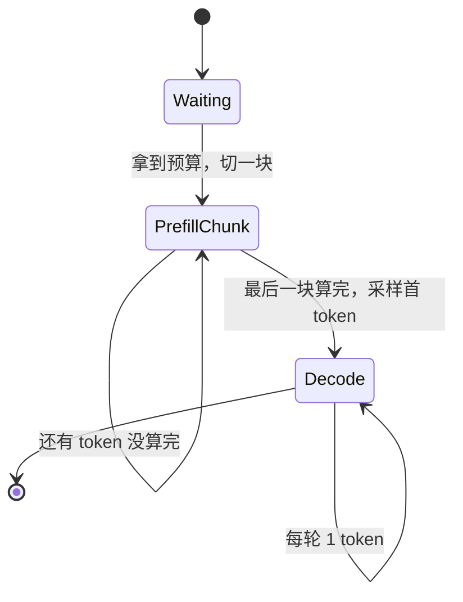

# Chunked Prefill 分块预填充

> 一句话：把一条长 prompt 的 prefill 按 token 切成若干块，每个 iteration 只推进一块，剩下的 token 预算塞给正在解码的请求。它给「一次迭代要算多少 token」硬加了一个上界，于是吞吐和 ITL（inter-token latency）第一次可以分开调。想法出自 Sarathi（2023）与 Sarathi-Serve（2024），现在已经是 vLLM V1 的默认调度行为。

| 项目 | 内容 |
|------|------|
| 要解决的问题 | 长 prefill 独占一个 iteration，正在 decode 的请求全部停摆，ITL 出尖刺 |
| 关键旋钮 | 每 iteration 的 token 预算（vLLM：`max_num_batched_tokens`，默认 8192） |
| 核心机制 | 预算约束 + decode 优先 + prefill 按剩余预算切块 |
| 主要收益 | ITL / P99 平滑、吞吐提升、PP bubble 减少、prefill 激活显存峰值下降 |
| 主要代价 | TTFT 略升、每步固定开销被摊薄到更少 token、kernel 与调度复杂度上升 |
| 代表实现 | vLLM V1、SGLang、Sarathi-Serve、DeepSpeed-FastGen（Dynamic SplitFuse） |

## 1. 出发点：prefill 和 decode 是两种硬件画像

同一个模型，两个阶段的算术强度差了两个数量级。设模型参数量 $N$、这一轮要算的 token 数 $T$：前向 FLOPs 约为 $2NT$，而要读的权重永远是 $2N$ 字节（FP16）。

| | Prefill | Decode |
|---|---|---|
| 一次算的 token | $T$（整条 prompt 或一个 chunk） | 每请求 1 个 |
| 权重读取 | 1 次 / iteration | 1 次 / iteration |
| 每 token 访存 | 权重被摊到 $T$ 个 token | 全量权重 + 整条 KV |
| 算术强度 | $\approx T$ FLOP/byte | $\approx 1$ FLOP/byte（batch = 1） |
| 瓶颈 | 算力（tensor core） | HBM 带宽 |
| 怎么打满 GPU | 加长 chunk / 加长 prompt | 加大 batch |

A100 的 FP16 算力 312 TFLOPS、HBM 带宽 2 TB/s，roofline 拐点在 $312/2 \approx 156$ FLOP/byte。7B 模型：

- **decode（batch = 1）**：强度只有 ~1 FLOP/byte，远在拐点左边。读一遍 14 GB 权重约 7 ms，这 7 ms 里只算了 14 GFLOP → 约 2 TFLOPS，是峰值的 0.6%。
- **prefill**：强度约等于 $T$，**只要 $T$ 超过 156 个 token 就已经是 compute-bound**。所以 prefill 不需要大 batch 就能把 GPU 打满，一条长 prompt 足够。

这解释了两件事：为什么 decode 必须靠 batch 摊薄权重读取；为什么把 prefill 塞进 batch 会让「这一轮有多长」由 prefill 决定，而不是由 decode 决定。

## 2. 不分块会怎样

Continuous batching 早就允许 prefill 和 decode 进同一个 forward，问题不在「能不能混」，而在**粒度**：

- 一条 32K prompt 整体进来，这个 iteration 要在 GPU 上算 3.2 万 token。这一轮几十到几百毫秒，期间所有正在输出的请求都卡在这一步，ITL 从 ~20 ms 变成几百毫秒，P99 直接爆。
- 想保 ITL，只能让长 prefill 排队等空闲窗口，于是队头阻塞（head-of-line blocking）：长请求的 TTFT 失控，新请求迟迟开不了，batch 反而变小，吞吐一起掉。

换成 iteration 视角看得更清楚（chunk = 2048，7B / A100，量级估算）：

| iteration | 不分块 | 分块（chunk = 2048） |
|---|---|---|
| 1 | prefill 32K + 8 decode，~2.4 s | prefill 2048 + 8 decode，~154 ms |
| 2 | — | prefill 2048 + 8 decode，~154 ms |
| … | — | …（共 16 轮） |
| 16 | — | prefill 最后一块，首 token 产出 |
| 之后 | decode 独占预算 | decode 独占预算 |

注意分块的 TTFT 其实没怎么变差：prefill 的总算力 $\alpha L$ 不变，多付的只是 16 次「读一遍权重」的地板开销 $\approx 16 \times 7\text{ ms} \approx 0.11\text{ s}$，相对 2.4 s 约 5%。

!!! note "常见误解：chunked prefill 会把 TTFT 拖长"
    它确实会增加 TTFT，但增量是 $\frac{L}{n}\beta$（迭代次数 × 单步地板），不是「变慢一个数量级」。真正让 TTFT 变长的是排队和抢占；分块反而因为不阻塞新请求、batch 更满，常常让吞吐更高、平均 TTFT 更稳。代价主要落在「预算被 decode 占掉的那部分 prefill 进度」上。

## 3. 机制

每个 iteration 有一个 token 预算 $B$（vLLM 的 `max_num_batched_tokens`）。调度器先把 running 请求各排 1 个 decode token，剩下的预算分给等待中的 prefill；装不下就切一块，没算完的下次再来：

```python
budget = max_num_batched_tokens
batch = []

# 1) decode 优先：每个 running 请求各 1 个 token
for req in running_requests:
    if budget == 0:
        break
    batch.append((req, 1))
    budget -= 1

# 2) 剩余预算喂 prefill，放不下就切块
for req in waiting_requests:
    n = min(req.num_prompt_tokens - req.num_computed_tokens, budget)
    if n == 0:
        break
    batch.append((req, n))
    budget -= n
    req.num_computed_tokens += n
```

这个循环每轮产出「每个请求这一步要算多少 token」的映射（vLLM V1 里是 `num_scheduled_tokens`），worker 侧按它切 `input_ids` 和 `position_ids`。于是一个 batch 只有三种形态：

1. **纯 decode**：预算全部被 1-token 请求吃掉；
2. **混批**：1 个 prefill chunk + 若干 decode，这是 chunked prefill 的常态，也是它赚钱的地方；
3. **纯 prefill chunk**：队列里没有 decode 可插（冷启动、或负载很轻）。

请求侧的状态机很简单：`num_computed_tokens` 从 0 涨到 `prompt_len` 之前都算 prefill，中途每块只写 KV、不采样；最后一块算完、产出第一个 token，转入 decode。



对模型前向有三个要求：

1. **位置编号连续**：chunk 的 `position_ids` 从 `num_computed_tokens` 起算，不能从 0 开始；
2. **mask 是「前缀 + 本块」的 causal**：块内 token 之间保持因果，但都能看见前 $p$ 个已经落盘的 KV，等价于 $n$ 个 query 对 $p+n$ 个 key 做 causal attention；
3. **变长打包**：一个 batch 里 q_len 混杂（chunk 长度 + 若干 1），需要 varlen / packed 注意力（`cu_seqlens` + block table）。FlashAttention 的变长接口天然支持，decode 就是 q_len = 1 的特例——这是混批能落地的 kernel 前提，见 [FlashAttention](flash-attention.md)。

KV 按 block 写进 paged cache（[Paged Attention](paged-attention.md)），「算过」和「存下了」的粒度因此一致；请求被抢占重算时，也能从任意已算位置续算，不用从头来。

## 4. 收益

**4.1 ITL 有上界。** 每个 decode 请求一步的延迟 ≈ 这个 iteration 的耗时 ≈ 最多一个 chunk 的代价。预算 $B$ 固定，ITL 的 P99 就被 $B$ 钉住，和「队列里有没有长 prompt」基本脱钩。这是 chunked prefill 最核心的承诺：把延迟和「到达的 prompt 有多长」解耦。

**4.2 吞吐。** prefill 是 compute-bound、decode 是 memory-bound。decode 塞进 prefill 的 iteration 几乎是免费的（算力还有余，只是多读几个 KV block、多算几个 1-token 的 GEMM），Sarathi 称之为 decode-maximal batching——让 decode 搭 prefill 的车。反过来，大 batch 的 decode 也不再阻止 prefill 推进。Sarathi-Serve 的实测：Mistral-7B / 单 A100 在尾延迟约束下服务容量 2.6×，Yi-34B / 2×A100 3.7×，Falcon-180B 配合 PP 5.6×；Sarathi 更早的版本里，LLaMA-13B / A6000 的 decode 吞吐最高 10×。

**4.3 流水线并行。** chunk 让各 iteration 的计算量均匀，micro-batch 之间不再一长一短，pipeline bubble 显著减少（Sarathi 报 6.29× 的 bubble 缩减）。这也是 PP 部署里 chunked prefill 几乎是标配的原因。

**4.4 显存峰值。** 一整条 128K prompt 的 prefill 激活值（attention 的 Q/K/V、MLP 中间层）可能几十 GB；分块后峰值只和 chunk 长度有关。长上下文能跑起来，很多时候靠的就是这一条。

**4.5 stall-free。** 正在跑的 decode 不会被「暂停」等 prefill 算完，新请求的 chunk 下一轮就能进 batch。Sarathi-Serve 相对早期 vLLM（prefill 优先、把 decode 排除在 prefill iteration 之外）的改进点主要就在这里。

## 5. 代价与调参

### 5.1 单步成本模型

一个 iteration 的耗时可以粗写成

$$
T_{\text{iter}} \approx \max\bigl(\beta,\ \alpha \cdot n\bigr),
\qquad
\alpha \approx \frac{2N}{\text{有效 FLOPS}},
\qquad
\beta \approx \frac{\text{权重字节数}}{\text{HBM 带宽}}
$$

其中 $n$ 是这个 iteration 真正算的 token 数。7B / FP16 在 A100 上：$\beta \approx 7$ ms（14 GB / 2 TB/s），$\alpha \approx 75\ \mu s$/token（约 1.3 万 tok/s 的 prefill，约 50% MFU）。代入得到一张很有用的表：

| 每轮 token 数 $n$ | $T_{\text{iter}}$ | 说明 |
|---|---|---|
| 128 | ~10 ms | 已接近地板，再小基本没有收益 |
| 512 | ~40 ms | ITL 敏感（实时对话、语音）的常用档 |
| 2048 | ~154 ms | 交互式聊天的折中 |
| 8192 | ~615 ms | 吃吞吐，ITL 完全让位于 TTFT |

**存在一个最优区间**：$n \ll \beta/\alpha \approx 100$ 时，单步时间被「读一遍权重」的地板卡死，切得越细只是多跑几轮、并行度不变；$n$ 太大时 decode 被拖死。所以调参不是「越小越好」，而是「按业务要保的 ITL，取刚好压在 $T_{\text{iter}}$ 以内的 $n$」。

### 5.2 常见旋钮（vLLM）

| 参数 | 作用 | 经验 |
|---|---|---|
| `max_num_batched_tokens` | 每 iteration 的 token 预算 $B$ | 2048 保 ITL；≥ 8192 冲吞吐；等于 `max_model_len` 时几乎是 V0 的旧行为（仍 decode 优先） |
| `max_num_seqs` | 纯 decode 场景的并发上限 | 和 $B$ 一起决定 batch 的组成 |
| `--enable-chunked-prefill` | V1 默认开启；V0 需显式打开 | 关掉时 $B$ 必须大于 `max_model_len`，否则可能起不来 |

官方口径：V1 下 chunked prefill **默认开启**，调度策略是 **decode 优先**——先排完全部 pending decode，再用剩余预算排 prefill，放不下就自动切块；小预算（如 2048）换来更好的 ITL，大预算换来更好的 TTFT。

### 5.3 其他代价

- **TTFT 多出 $\frac{L}{n}\beta$**：$L$ 越长、chunk 越小，多读权重的次数越多（32K prompt、chunk = 512 → 64 次 ≈ 0.45 s）。
- **每步固定开销被摊薄**：kernel launch、通信、调度、CUDA graph 重放都按 iteration 计。chunk 尺寸可变，导致只能做分段（piecewise）CUDA graph，用不了尺寸固定的整图重放。
- **前缀缓存的粒度**：命中前缀直接跳过，只剩未命中的后缀要算；chunk 边界与 block 边界不对齐时，块内已算的 KV 短时间无法被别的请求复用，见 [KV Cache](kv-cache.md)。
- **状态型架构**：线性注意力 / SSM 层（见 [混合注意力](../../现代模型架构/07-混合注意力.md)）除了 KV 还有随 chunk 递推的状态，分块在算法层面就要配套 chunkwise kernel，不能只把 KV 切开。

## 6. 和邻居们的关系

| 技术 | 关系 |
|---|---|
| Continuous Batching | 提供「一个 batch 装多个请求」的容器；chunked prefill 决定容器里放什么比例 |
| PagedAttention | KV 按 block 落盘，chunk 才能「算一块、写一块」，已算位置也不必重算 |
| FlashAttention | varlen / packed 接口让 chunk 和 decode 混在同一个 kernel 里 |
| Prefix Caching | 命中部分不再是 prefill 成本，chunk 只剩未命中后缀 |
| PD 分离 | prefill 与 decode 分到不同实例后，prefill 节点不用再为别人的 ITL 让步，整条 prefill 一次算完往往更快；chunked prefill 退化为控制显存峰值、流式传 KV 的可选手段 |
| 投机采样 | 验证阶段一次算 $k+1$ 个 token，本质是「小 chunk 的 prefill」，同样搭 decode 的车 |
| Dynamic SplitFuse | DeepSpeed-FastGen 的同族方案：把 prompt 切成固定小段与 decode 混批，思路一致、实现细节不同 |

## 7. 什么时候不该用

- **离线批量推理**：没有 ITL 要求，整条 prefill 一次算完步骤最少、TTFT 最短。
- **单请求 / 无并发**：没有 decode 可搭车，分块只多付迭代开销——除非就是为了压激活显存。
- **极短 prompt 的对话**：prompt 本来只有几百 token，chunk 粒度没有意义。
- **已经做了 PD 分离、P 节点只跑 prefill**：分块的主要动机（保护 decode 的 ITL）不存在了。

## 8. 参考

- [SARATHI: Efficient LLM Inference by Piggybacking Decodes with Chunked Prefills](https://arxiv.org/abs/2308.16369)（arXiv 2308.16369）
- [Taming Throughput-Latency Tradeoff in LLM Inference with Sarathi-Serve](https://arxiv.org/abs/2403.02310)（arXiv 2403.02310，OSDI'24）
- [DeepSpeed-FastGen: High-throughput Text Generation for LLMs via MII and DeepSpeed-Inference](https://arxiv.org/abs/2401.08671)（Dynamic SplitFuse）
- [vLLM 文档 - Optimization and Tuning: Chunked Prefill](https://docs.vllm.ai/en/latest/configuration/optimization/)
- [基于 chunked prefill 理解 prefill 和 decode 的计算特性 - 知乎](https://zhuanlan.zhihu.com/p/718715866)
- [cr7258/ai-infra-learning: lesson 05 chunked prefills](https://github.com/cr7258/ai-infra-learning/tree/main/lesson/05-chunked-prefills)
