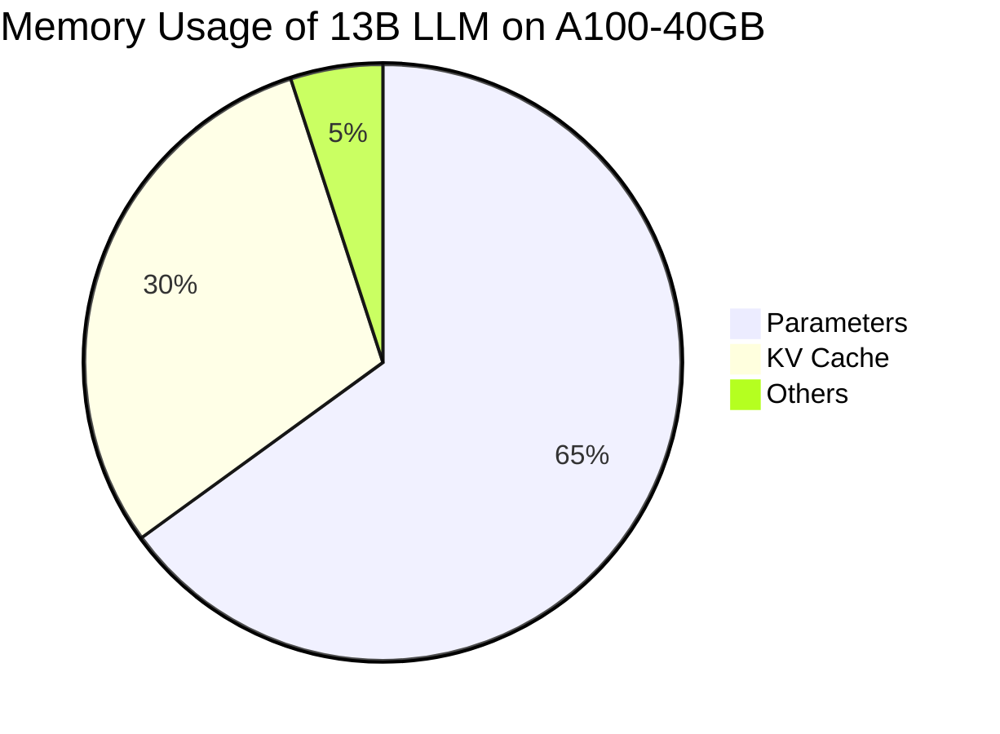

## Key-value cache

- Key-value cache

<iframe src="//player.bilibili.com/player.html?isOutside=true&aid=1006179366&bvid=BV1kx4y1x7bu&cid=1616577437&p=1&autoplay=0&high_quality=1&danmaku=0" scrolling="no" border="0" frameborder="no" framespacing="0" allowfullscreen="true" width="100%" height="500px"></iframe>

### 原理

在 Decoder 阶段，使用 Auto Regressive 机制

$$
Attention(Q,K,V) = softmax(\frac{QK^T}{\sqrt{d_k}})V
$$

由于有 Mask 机制，每次有新的 token 加入的时候，只需要做$Q_{new}$和$K_{old}$的注意力计算，而不用重新计算整个序列。

所以，我们只需要保存 $K_{old}$ 和 $V_{old}$ (因为只用到了 KV)，就可以实现高效的增量生成。每生成一个 token，只做三步：

1. 计算当前 token 的 $q_t$、$k_t$、$v_t$
2. 把 $k_t$、$v_t$ 追加到缓存
3. 用 $q_t$ 与缓存中所有 $K$、$V$ 做注意力计算


```python
# 第 t+1 个 token，第 l 层
h = h_{t+1}^{(l)}                        # 上一层输出
q = W_q[l] · h                           # (1, d_h) 每个头一份
k = W_k[l] · h
v = W_v[l] · h

K_cache[l].append(k)                     # ← 先写
V_cache[l].append(v)                     #   此刻长度 = t+1

s = q · K_cache[l].T                     # (1, t+1) —— 概念上的「最后一行」
p = softmax(s)                           # 不施加因果 mask，所有列都合法
o = p · V_cache[l]                       # (1, d_h)

h_{t+1}^{(l+1)} = MLP( h + W_o[l] · o )  # 进入下一层
```


值得注意的是，KV 缓存的大小通常和模型本身大小是同一级别，也是一种空间换时间的策略




### 为什么不缓存 Query?

理论上 Query 也可以缓存，但没有意义：

- 在生成第 $t$ 步时，我们只需要当前 token 的 $q_t$ 来做注意力查询
- 历史位置 $1,\ldots,t-1$ 的 Query 在当前步骤中不会再被用到（因果注意力只向前看）
- Query 不参与后续步骤的计算，缓存它只会浪费内存

Key 和 Value 则不同：每次生成新 token，当前的 $q_t$ 都需要与所有历史 token 的 $k_i$、$v_i$ 做注意力，所以缓存 $K$、$V$ 是有实际收益的。

### 内存占用

以 LLaMA-2 70B 为例：

| 参数 | 值 |
|---|---|
| 层数 $L$ | 80 |
| 注意力头数 $H$ | 64 |
| KV 头数（GQA） | 8 |
| 头维度 $d_k$ | 128 |
| 精度 | FP16（2 bytes） |

标准 MHA 下，序列长度为 $t$ 时，单条请求的 KV Cache 是：

$$
\begin{aligned}
\text{Size}
&= 2 \times L \times H \times d_k \times t \times 2\text{ bytes} \\
&= 2 \times 80 \times 64 \times 128 \times 2 \times t\text{ bytes} \\
&= 2621440 \times t\text{ bytes}
\approx 2.5\text{ MB/token}
\end{aligned}
$$

序列长 4096 时，$2.5\text{ MB} \times 4096 \approx 10\text{ GB}$。LLaMA-2 70B 权重本身（FP16）约 140 GB，所以：

- 单条长序列的 KV Cache 就能占几十 GB 显存
- 批量并发（batch size = 32）时，KV Cache 可以超过模型权重本身

这个模型实际是 GQA，KV 头数是 8 而不是 64。把式子里的 $H$ 换成 8，约为 $0.31\text{ MB/token}$，4096 token 约 1.25 GB。上面的 10 GB 是「每个查询头各存一份 K/V」的上界。

### 动态性

和权重不同，KV Cache 有几个难处理的特点：

- **动态增长。** 每生成一个 token 就长一块，请求开始前很难把内存一次分好。
- **长度差异大。** 有的请求只生成 10 个 token，有的生成 10000 个。按最大长度预分配，浪费很严重；改成动态分配，又容易产生碎片。
- **批处理长度不齐。** 同一个 batch 里，各请求停在不同的生成步，KV Cache 长度不同，很难打成规则张量。

vLLM 论文里的实验：朴素实现下，碎片可以浪费 60–80% 的可用显存。对应的做法见 [Paged Attention](./paged-attention.md)。

https://zhuanlan.zhihu.com/p/2016843212178882587