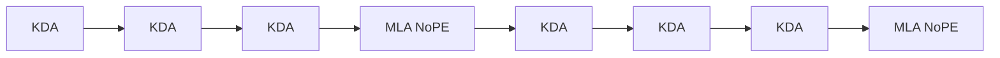

# 滑窗、线性注意力与混合层

> 全注意力之外的三条路：滑窗、线性注意力 / SSM、以及按层混合。代表模型是 [Qwen3-Next](https://www.alibabacloud.com/blog/602580)、[Kimi Linear](https://arxiv.org/abs/2510.26692)、[MiniMax-01](https://arxiv.org/abs/2501.08313)，滑窗一侧是 Mistral 的 SWA 和 gpt-oss 的交替窗口。这篇只讲「历史存在哪」，不讲「看多少 token」——后者在 [05-NSA](./06-NSA&MoBA.md) 和 [06-DSA](./07-DSA.md)。

## 为什么 2025 之后又回头做「全注意力之外」

三条轴要一直分清：共享程度、缓存宽度、参与计算的 token 数。混合层动的是第四条，也是最根本的一条：**历史到底以什么形式存在。**

全注意力把历史原样存成 KV，每个 token 一份，长度 $L$ 就 $L$ 份。prefill 时算力是 $O(L^2)$，decode 时更难受：每生成一个 token 都要把整条 KV 从 HBM 读一遍，是纯访存瓶颈。KV 跟着 $L$ 线性涨，带宽也线性涨，算术强度却一直掉。

线性注意力换了个存法：把历史压进一个固定大小的状态 $S$，于是缓存 $O(1)$，与长度无关：

$$
S_t = \alpha_t \odot S_{t-1} + \beta_t\, k_t v_t^{\top}, \qquad o_t = S_t^{\top} q_t
$$

门控 $\alpha_t$ 决定忘多少，写入项决定记什么。状态大小是 $n_h \times d_k \times d_v$，常数。代价同样直接：**固定大小的记忆装不下精确的历史。** 想找回第 9000 个 token 里那个具体的数字，只能靠状态里还残留的压缩痕迹。

## 路线一：滑窗加 attention sink

最省事的做法是只留最近 $W$ 个 token。Mistral 7B 用 $W = 4096$，配 rolling buffer cache，缓存大小固定为 $W$（[Mistral 7B](https://arxiv.org/abs/2310.06825)）；32 层堆下来，理论感受野约 $32 \times 4096 \approx 131$K。层数把窗口叠成长距离，这是 SWA 唯一的长程信息来源。

滑窗有两个硬伤：

- **全局检索直接没了。** 窗口外的 token 在推理时根本不可见，问「第 3 页写的那个数」必错。
- **窗口一缩，模型就崩。** 只留最近 $W$ 个 token 时，softmax 的分母少了一大块，分布立刻偏掉。

[StreamingLLM](https://arxiv.org/abs/2309.17453) 解释了第二点：初始几个 token 会吸走大量注意力，充当 **attention sink**，本身没有语义重要性。把这 4 个初始 token 的 KV 一直留着，窗口注意力的困惑度就基本恢复，不用微调也能跑到 4M token；流式场景下比滑窗加滑动重算快约 22.2×。

但要记准它救的是什么：sink 只保住「开头几个 token」，让分布不崩，**不提供全局检索能力**。它是个稳定器，不是记忆。

gpt-oss 走的是另一种折中：让带状的滑窗层和全注意力层交替，窗口只有 128 个 token，全局信息全靠那些全注意力层；64 个查询头、8 个 KV 头的 GQA，YaRN 把全注意力层的上下文拉到 131072。softmax 里另加一个可学习的 sink 项，让注意力可以「什么都不看」。

## 路线二：线性注意力与 SSM

这一支的现代版本都建立在同一个视角上：**状态更新就是在做在线学习。**

- [Mamba-2](https://arxiv.org/abs/2405.21060) 的 SSD 框架说明 SSM 和注意力是同一类结构化矩阵乘法的两面，核心层比 Mamba 快 2–8×，这才让 SSM 层真正能进大模型。
- [Gated DeltaNet](https://arxiv.org/abs/2412.06464) 把两种机制合起来：门控负责快速擦除，delta rule 负责精确改写。delta rule 可以读成对重建误差做一步梯度下降，而不是无脑累加。论文自己就给了两种混合配方：配滑窗，或配 Mamba2。
- Kimi 的 **KDA** 把 Gated DeltaNet 的「每头一个标量遗忘率」改成通道级，状态的每个特征维度有自己的衰减，并用对角加低秩（DPLR）的分块算法把它做成 GPU 上划算的 kernel。
- MiniMax 的 **Lightning Attention** 是 I/O 感知实现：块内和块间的矩阵乘分开做，避开朴素因果线性注意力里那次昂贵的累加扫描。

线性层真正擅长的是**位置和近邻**：状态总是最近写的，越近的 token 影响越大，这正好是语言模型最需要的那部分。它不擅长的是**一个精确的、远处的键值对**——那需要把某条具体信息原样存住。

## 混合比：7 : 1 到 3 : 1

既然两种记忆互补，主流做法就变成按层混：

| 模型 | 线性层 | 全局层 | 比例 | 备注 |
|------|--------|--------|------|------|
| [MiniMax-01](https://arxiv.org/abs/2501.08313) | Lightning Attention | 普通 GQA softmax | 7 : 1 | 80 层；456B / 45.9B；1M 训练 / 4M 推理 |
| [Qwen3-Next](https://www.alibabacloud.com/blog/602580) | Gated DeltaNet | 带输出门的 GQA | 3 : 1 | 80B / 3B；原生约 262K |
| [Kimi Linear](https://arxiv.org/abs/2510.26692) | KDA | NoPE 的 MLA | 3 : 1 | 48B / 3B；1M 下 KV 最多降 75%，解码吞吐最高约 6× |

几点必须分清：

- **混合是按层，不是按头。** 不是「一半头做线性、一半头做 softmax」，而是整层整层地换。
- **比例在变密。** MiniMax 做过小规模对照：拿 28B 总参 / 5B 激活的 MoE，每 8 层里把前 7 层的 softmax 换成 Lightning Attention，大多数基准反而更好；纯线性又检索太弱，所以留 1 层兜底。后来的两家都收到 3 : 1。Kimi 的消融里 3 : 1 最好，7 : 1 训练损失接近但验证明显变差，1 : 1 验证还行但推理更贵，纯全注意力在他们的设置里更差。
- **全局层保留谁，各家不同。** Qwen3-Next 保留带输出门的标准注意力（每头维度从 128 提到 256，RoPE 只加在前 25% 的位置维度）。Kimi 保留 MLA 且这些层是 NoPE，位置全交给 KDA，推理时 MLA 收成纯 MQA，也不必再调 RoPE 频率基。MiniMax 最保守，就是普通 GQA（64 头、每头 128 维、组大小 8）。
- 所以「线性层负责位置和近邻、全局层负责精确召回」这句话，在 Kimi 那里是字面成立的（全局层连位置编码都不要）；在 Qwen 那里只成立一半，全局层还留了 1/4 维的 RoPE。

## 状态和 KV 到底谁更省

以 Kimi 的 KDA 为例，key/value 头维都是 128，一个头的状态是 $128 \times 128 = 16384$ 个元素。MLA 每 token 每层是 $d_c + d_R = 576$ 个元素。

于是有个容易被忽略的事实：**线性层不是免费的，它是把「随 $L$ 增长」换成「一次性的常数」。**

$$
\text{线性层}: n_h \cdot d_k \cdot d_v \;(\text{与 } L \text{ 无关})
\qquad\text{vs}\qquad
\text{softmax 层}: L \cdot (d_c + d_R)
$$

粗算一下交叉点：$n_h = 12$ 时状态是约 19.7 万个元素，除以 576 得到约 340 个 token。也就是说几十万 token 的上下文里线性层远远更省，但在几百 token 的短序列上它并不划算。这是估算，实际取决于头数、层宽和是否算上卷积分支的状态——只用来建立量级感。

## 工程影响：cache 变成「每层不同」

这是混合架构真正麻烦的地方，也是面试里能拉开差距的点。

1. **不能再用一个统一的 KV 池。** PagedAttention 的整套假设是「所有层结构相同，一个 block table 打通」。混合模型里线性层的状态是 $n_h \times d_k \times d_v$ 的固定张量，softmax 层的缓存是随 $L$ 增长的 KV，两者的生命周期、分配粒度、是否可共享都不同。引擎要么分池，要么做一层抽象的 token 级分配。
2. **前缀缓存和 PD 分离的粒度变了。** 前缀命中要连状态一起复用；prefill 节点往 decode 节点传的不再是单一形态的 KV，而是两类东西，传输量得按层类型分别算。
3. **两套 kernel。** 线性层 prefill 用分块并行的矩阵乘形式，decode 退化成递归形式，两条路径都要有；Kimi Linear 开源了 KDA 的 chunkwise kernel。
4. **投机解码和回滚。** 线性层的状态不能像 KV 那样「截断到前 $L$ 个」就还原，要多存 checkpoint。MTP 或投机解码被拒时，状态回滚的成本和 KV 不一样。

## 和 NSA / DSA 的关系

正交，可以叠加：

- **NSA / DSA** 改的是「每个查询参与计算的 token 数」，历史还是原样存 KV，只是少看一些。
- **混合层** 改的是「历史以什么形式存在」，多少 token 参与计算是另一回事。

一个用混合层的模型照样可以在全局层上再加稀疏选择；V4 的 CSA / HCA 则是在压缩槽上做稀疏或稠密注意力，属于第三条路——先压序列再选。

## 什么时候选哪条

- 上下文中等、精确检索要求高：全注意力加稀疏选择（[DSA](./07-DSA.md) 那一类）。
- 上下文极长、成本敏感、任务以长文阅读和智能体轨迹为主：混合层。
- 短中期的判断：**混合层是主流候选，纯线性还差精确召回。** 三家大模型都是「线性层为主 + 少量全局层」，没有一家交纯线性；而 Kimi 的论点是，在公平对比下这套混合不只是更省，还能超过全 MLA。

## 面试里怎么收束

> 长上下文 decode 是访存瓶颈，全注意力的 KV 随长度线性涨。线性注意力把历史压进固定状态，缓存变成常数，但固定状态装不下精确的远距离信息。所以 2025 年之后的做法是按层混：MiniMax 是 7 层 Lightning 配 1 层 GQA，Qwen3-Next 和 Kimi Linear 都是 3 层线性配 1 层全局。线性层负责位置和近邻，全局层负责精确召回；Kimi 的全局层甚至是 NoPE 的 MLA，推理时退化成 MQA。工程上最麻烦的是 cache 变成每层不同，PagedAttention 要分池。这条线和 NSA / DSA 正交，一个换状态形式，一个减 token 数。

## 参考

- [Gated DeltaNet](https://arxiv.org/abs/2412.06464)（arXiv 2412.06464）
- [Mamba-2 / SSD](https://arxiv.org/abs/2405.21060)（arXiv 2405.21060）
- [StreamingLLM / attention sink](https://arxiv.org/abs/2309.17453)（arXiv 2309.17453）
- [Kimi Linear](https://arxiv.org/abs/2510.26692)（arXiv 2510.26692）
- [MiniMax-01](https://arxiv.org/abs/2501.08313)（arXiv 2501.08313）
- [Qwen3-Next 官方博客](https://www.alibabacloud.com/blog/602580) · [Mistral 7B](https://arxiv.org/abs/2310.06825)
