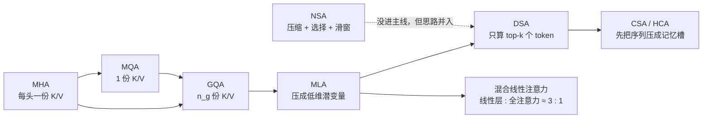

# 现代模型架构

这个目录只讲一件事：**Transformer 的注意力块，从 2017 到今天被改了哪些地方**。一篇一个方法，机制层面的横向对比；某个具体模型的整体叙事（MoE、训练配方、后训练）在 [前沿基座模型](../frontier/index.md) 里。

## 先分清三条轴

所有变体都能归到四条轴中的一条（V4 之后是两条同时用）：

| 轴 | 做法 | 代表 |
|---|---|---|
| 共享程度 | 少存几份 K/V | MQA → GQA |
| 缓存宽度 | 把一份 K/V 压窄 | MLA |
| 参与计算的 token 数 | 只算最相关的那些 | NSA、DSA |
| 换范式 | 用固定大小的状态替代 KV cache | 混合线性注意力（Gated DeltaNet / KDA） |

看清这一点，就不会把「DSA 又压了一次 MLA 的宽度」说出口——DSA 压的是 token 数，MLA 压的是宽度，两者正交且可以叠加。

## 速查表

| 方法 | 改的是哪条轴 | 每 token 每层缓存 | 注意力复杂度 | 代表模型 |
|---|---|---|---|---|
| [MHA](./01-MHA.md) | 基准 | $2 n_h d_h$ | $O(L^2)$ | GPT-3 一代 |
| [MQA](./02-MQA.md) | 共享份数 $\to 1$ | $2 d_h$ | $O(L^2)$ | PaLM、Falcon |
| [GQA](./03-GQA.md) | 共享份数 $\to n_g$ | $2 n_g d_h$ | $O(L^2)$ | Llama 3、Qwen3、Gemma |
| [MLA](./04-MLA.md) | 缓存宽度 | $d_c + d_R$（V2/V3 为 576） | $O(L^2)$，单步访存大降 | DeepSeek-V2 / V3 |
| [NSA](./06-NSA&MoBA.md) | 参与计算的 token 数 | 不压（同基座） | 近似 $O(L)$ | 研究模型（27B 级） |
| [DSA](./07-DSA.md) | 参与计算的 token 数 | 同 MLA | $O(Lk)$ + 廉价 indexer | DeepSeek-V3.2 |
| [混合注意力](./07-混合注意力.md) | 换范式 | 线性层 $O(1)$ + 全局层 KV | 线性层 $O(L)$ | Qwen3-Next、Kimi Linear、MiniMax-01 |
| [CSA](./CSA.md) / HCA | 先压缩序列 | 每个记忆槽一份 | $O(L \cdot k / m)$ 量级 | DeepSeek-V4 |

数字看两处：**每 token 每层的缓存**决定长上下文能装多少请求，**复杂度**决定长序列算多久。两件事经常被混着说。

## 阅读顺序

1. [MHA](./01-MHA.md)：先把 decode 的访存账算清楚，后面的动机才立得住。
2. [MQA](./02-MQA.md) → [GQA](./03-GQA.md)：最直接的「少存几份」。
3. [MLA](./04-MLA.md)：换存法，目前长上下文的第一主力。
4. [NSA](./06-NSA&MoBA.md) → [DSA](./07-DSA.md)：从「减宽度」到「减 token」，这是 2025 年的主线。
5. [CSA](./CSA.md)：先把每 4 个 token 压成 1 条槽，再在槽上做 DSA。HCA 是更重的压缩、不再 top-k。
6. [混合注意力](./07-混合注意力.md)：不是所有模型都走稀疏，另一支直接换掉 softmax 的历史表示。

## 术语约定

| 符号 | 含义 |
|---|---|
| $n_h$ | 查询头数 |
| $d_h$ | 每个头的维度 |
| $n_g$ | KV 分组数（MQA 为 1，MHA 为 $n_h$） |
| $d_c$ | MLA 潜变量维度 |
| $d_R$ | MLA 解耦 RoPE 的维度 |
| $L$ | 序列长度 |
| $k$ | 稀疏注意力每步选中的 token 数 |

## 一条主线

> 2017 年全注意力把 $O(L^2)$ 写进架构；2023 年 MQA / GQA 证明「少存几份 K/V」几乎不掉点，GQA-8 成了默认；2024 年 DeepSeek-V2 的 MLA 换了一种存法，把缓存压到 MHA 的约 1/57，长上下文第一次在显存上「够用」；2025 年注意力开始减 token——NSA 从预训练就稀疏，DSA 靠廉价 indexer 续训接入 V3.2；同时另一支用混合线性注意力换掉 softmax 的历史表示，Qwen3-Next 和 Kimi Linear 都是 3 : 1。到 V4，先把序列压成更少的记忆槽，再在槽上做稀疏：压宽度、减 token、缩序列，三级依次递进。

## 和 frontier 笔记的关系

- 本目录：**机制**层面的横向对比，一套符号算到底。
- [frontier](../frontier/index.md)：**模型**层面的纵向叙事，某个基座模型的 MoE、训练、后训练一起讲。
- 一一对应：[DeepSeek-V2](../frontier/09-deepseek-v2.md) 讲 MLA 的落地，[DeepSeek-V3.2](../frontier/11-deepseek-v32.md) 讲 DSA，[DeepSeek-V4](../frontier/12-deepseek-v4.md) 讲 CSA/HCA，[Qwen3-Next](../frontier/14-qwen3-next.md) 与 [Kimi Linear](../frontier/18-kimi-linear.md) 讲混合层，[MiniMax-01](../frontier/17-minimax.md) 讲 7 : 1。
- 只想过一遍面试：先看这页的速查表，再看 [架构面试提纲](../frontier/08-interview.md)。

## 参考

- [Attention Is All You Need](https://arxiv.org/abs/1706.03762)（2017）
- [DeepSeek-V2](https://arxiv.org/abs/2405.04434)（2024，MLA）
- [Native Sparse Attention](https://arxiv.org/abs/2502.11089)（2025，NSA）
- [DeepSeek-V3.2](https://arxiv.org/abs/2512.02556)（2025，DSA）
- [Kimi Linear](https://arxiv.org/abs/2510.26692)（2025，KDA 混合）
- [DeepSeek-V4](https://arxiv.org/abs/2606.19348)（2026，CSA/HCA）
- Sebastian Raschka, [The Big LLM Architecture Comparison](https://magazine.sebastianraschka.com/p/the-big-llm-architecture-comparison)（2025）
