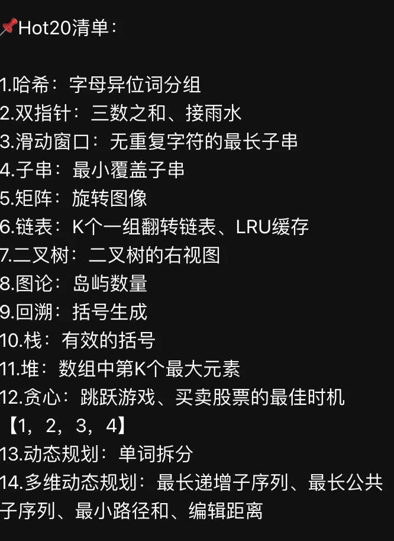

# 力扣 LeetCode

按一份流传很广的「**Hot 20 题单**」整理的题解库：14 类高频题型、20 道题。

- **按考察点分文件夹**：一个题型一个目录（`hash/`、`two-pointers/`、`substring/` …），目录里的 `index.md` 写这一类的识别标志、模板骨架、易错点和题目清单。
- **每题一页**：文件名是 `题目号-英文名.md`，页面结构固定：**题干**（完整题面 + 全部示例 + 提示）→ **思路** → **代码（带注释）** → **复杂度** → **教学动画（HTML）** → **易错点** → **延伸**。
- 题解来自实际刷题记录，不是抄题解：代码都在本地跑过样例，每道题都配了可以单步播放的**教学动画**（哈希入桶、双指针结算、滑动窗口、链表掉头、dp 表填格）。
- 目前整理了 **6 题**（✔），其余题在下面总表里标 ☐ 并附 LeetCode 链接，刷完再补页。

!!! tip "一页纸速记（A4 · 20 题全）"

    20 道题各一句话思路（带关键公式），压在一页里；★ 表示站内已有完整题解：

    [⤓ 下载速记 PDF](assets/hot20-cheatsheet.pdf){target=_blank .md-button} · [网页版（可直接 Cmd+P 打印）](assets/hot20-cheatsheet.html){target=_blank}

!!! tip "怎么用"

    - **第一次刷**：先只看「题干」自己动手，卡住了再读「思路」和动画，最后对代码。
    - **二刷复习**：只看每页的「易错点」和复杂度表，能在 3 分钟内复述出做法就算过。
    - **面试前**：从下面总表的「题型」点进对应目录，先把那一类的套路和模板骨架过一遍。

## 进度总览

题单共 **14 类 / 20 题**，目前本地已整理 **6 题**（✔），其余待补（☐）。带链接的「题型」是本库已建好的分类目录。

| # | 题型 | Hot 20 题目 | 核心套路（一句话） |
|:--|:--|:--|:--|
| 1 | [哈希](hash/index.md) | ✔ [49 字母异位词分组](hash/49-group-anagrams.md) | 造「只依赖字母构成」的规范形当键：排序 / 计数向量 / 质数乘积 |
| 2 | [双指针](two-pointers/index.md) | ✔ [42 接雨水](two-pointers/42-trapping-rain-water.md) · ☐ [15 三数之和](https://leetcode.cn/problems/3sum/) | 数组两端各站一个指针，每次结算「已经确定」的那一侧；三数之和靠排序 + 固定一个数 + 左右夹逼去重 |
| 3 | 滑动窗口 | ☐ [3 无重复字符的最长子串](https://leetcode.cn/problems/longest-substring-without-repeating-characters/) | 右指针负责扩张，左指针负责在「违规」时收缩，窗口内永远维护一个合法状态 |
| 4 | [子串](substring/index.md) | ✔ [76 最小覆盖子串](substring/76-minimum-window-substring.md) | 滑窗 + 「还欠多少」计数：欠账归零就收缩左边界并记录最短答案 |
| 5 | 矩阵 | ☐ [48 旋转图像](https://leetcode.cn/problems/rotate-image/) | 原地操作拆两步：先转置再左右翻转（顺时针），等价于四格轮换 |
| 6 | [链表](linked-list/index.md) | ✔ [25 K 个一组翻转链表](linked-list/25-reverse-nodes-in-k-group.md) · ☐ [146 LRU 缓存](https://leetcode.cn/problems/lru-cache/) | 哨兵 `dummy` 让第一组和后面共用一套逻辑；LRU = 哈希表 + 双向链表 |
| 7 | 二叉树 | ☐ [199 二叉树的右视图](https://leetcode.cn/problems/binary-tree-right-side-view/) | 层序遍历取每层最后一个，或 DFS 按「深度首次到达」记录 |
| 8 | 图论 | ☐ [200 岛屿数量](https://leetcode.cn/problems/number-of-islands/) | 网格当图：每碰到一个陆地就 DFS/BFS 淹掉整块，计数即连通块个数 |
| 9 | 回溯 | ☐ [22 括号生成](https://leetcode.cn/problems/generate-parentheses/) | 只往下走「合法」的分支：左括号不超上限、右括号不超左括号 |
| 10 | 栈 | ☐ [20 有效的括号](https://leetcode.cn/problems/valid-parentheses/) | 左括号入栈，右括号查栈顶是否配对，最后栈必须为空 |
| 11 | 堆 | ☐ [215 数组中的第 K 个最大元素](https://leetcode.cn/problems/kth-largest-element-in-an-array/) | 大小为 k 的小顶堆，或快速选择（平均 O(n)）；别全排序 |
| 12 | [贪心](greedy/index.md) | ✔ [188 买卖股票的最佳时机 IV](greedy/188-best-time-to-buy-and-sell-stock-iv.md) · ☐ [55 跳跃游戏](https://leetcode.cn/problems/jump-game/) | 维护「能到达的最远下标」，走不到下一个就失败；股票题每类交易数是一维 dp |
| 13 | [动态规划](dynamic-programming/index.md) | ✔ [139 单词拆分](dynamic-programming/139-word-break.md) | `dp[i]` = 前缀 `s[:i]` 能否拆出，转移看字典里每个词的尾巴 |
| 14 | 多维动态规划 | ☐ [300 最长递增子序列](https://leetcode.cn/problems/longest-increasing-subsequence/) · ☐ [1143 最长公共子序列](https://leetcode.cn/problems/longest-common-subsequence/) · ☐ [64 最小路径和](https://leetcode.cn/problems/minimum-path-sum/) · ☐ [72 编辑距离](https://leetcode.cn/problems/edit-distance/) | 两个维度至少就开二维 `dp[i][j]`：先定「前 i / 前 j 个」的含义，再写转移和边界 |

## 教学动画（HTML）

每道题都配了一页可以单步播放的动画（各自页面里也有入口），用来把「指针怎么动、dp 表怎么填」看明白：

| 动画 | 讲什么 | 快捷键 |
|:--|:--|:--|
| [字母异位词分组 · 哈希入桶](assets/group-anagrams.html) | 每个词：算签名 → 查表 → 入桶 | 空格播放，`←` `→` 单步 |
| [接雨水 · 双指针](assets/trapping-rain-water-two-pointers.html) | 每次结算更矮的一侧，水位由已见最大值决定 | 空格播放，`←` `→` 单步 |
| [K 个一组翻转链表 · 迭代](assets/reverse-nodes-in-k-group.html) | `dummy` + `groupPrev` 走 k 步找 `kth`，组内指针掉头 | 空格播放，`←` `→` 单步 |
| [买卖股票 IV · dp 表](assets/stock-iv.html) | `dp[t][i]` 逐格填，`best` 随卖出日右移更新 argmax | 空格播放，`←` `→` 单步 |
| [单词拆分 · dp 推导](assets/word-break.html) | 每个 `i` 试所有单词，命中就连出 `parent` 回溯分段 | 空格播放，`←` `→` 单步 |
| [最小覆盖子串 · 滑动窗口](assets/min-window-substring.html) | 右扩凑齐 → 左缩记录 → `formed` 计数怎么变 | 空格播放，`←` `→` 单步 |

## 题单原图

{ width="320" }

## 参考

- 题面与提交：[力扣中国站](https://leetcode.cn/problemset/)
- 本库基础笔记：[数据结构](../DS/00-intro.md) · [散列表与 hash](../DS/07-Hash.md)
